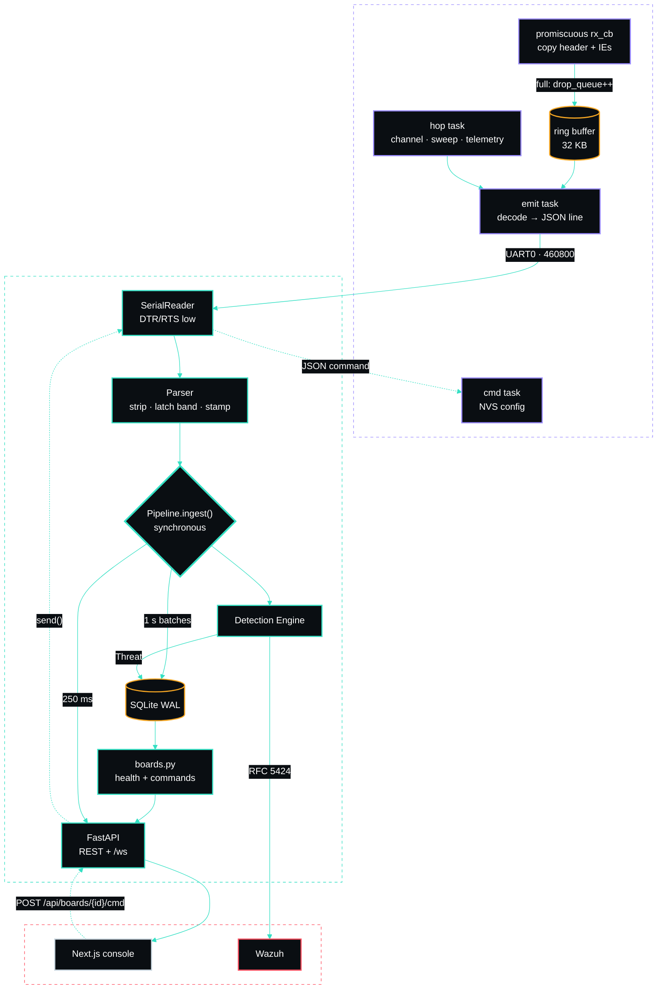
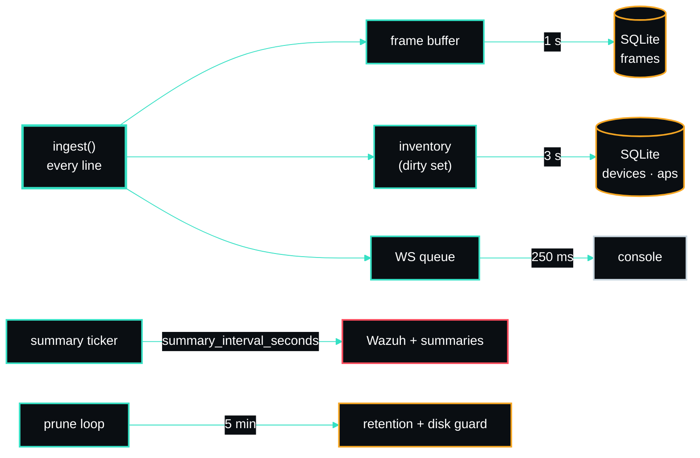
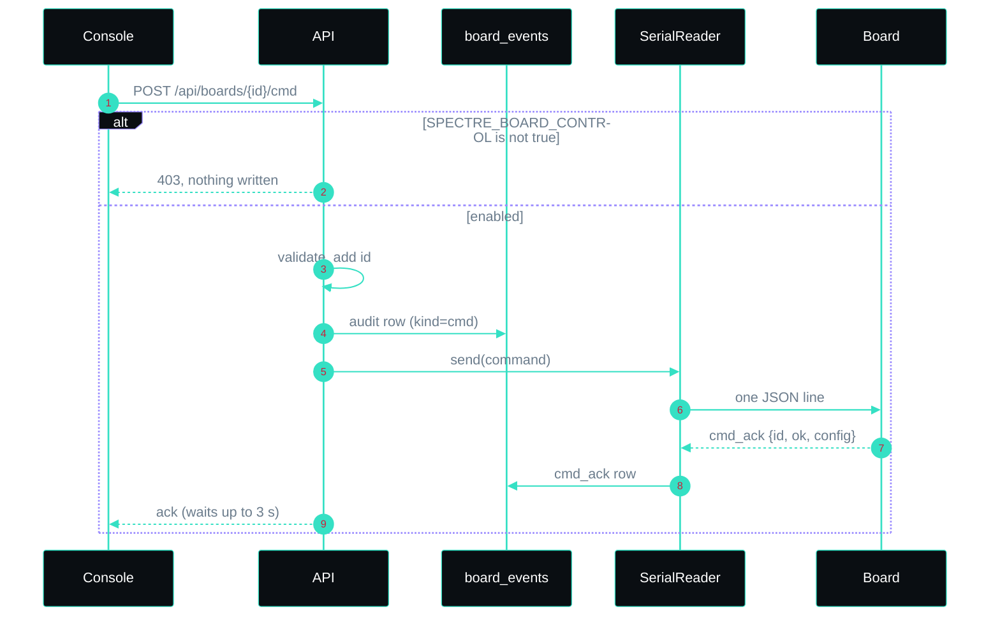

# Architecture

A frame's path, from the radio to the console and the SIEM, in three hops: the firmware on each board,
the sensor service, and its two consumers.

## Firmware (`firmware/spectre-sniffer`)

- **rx callback** runs in the Wi-Fi driver's context. It copies the 802.11 header and the information
  elements (data frames: 64 bytes, header only) plus the radio metadata into a ring buffer and returns. If
  the ring is full, the frame is counted in `drop_queue` instead of blocking the driver.
- **emit task** decodes each item (`core/`, portable C with no IDF dependency) into one JSON line and writes
  it to UART0. It also writes an `ap_info` line the first time a BSSID is seen and whenever its advertised
  configuration changes, and every `ap_info_s` seconds.
- **hop task** steps through the channel plan, and at dwell boundaries writes `channel_sweep_complete`,
  `telemetry` and `clock_sync` lines.
- **cmd task** reads JSON commands from the same UART, validates them, saves the config in NVS and acks.

Details: [firmware/README.md](../firmware/README.md).

## Sensor responsibilities

- **SerialReader** (`reader.py`) — one async task per port via `loop.add_reader`. Opens the tty
  with DTR/RTS cleared (stdlib `termios` `TIOCMBIC`) so the board keeps running, line-buffers, and
  hands raw lines to a per-port `Parser`. `send()` writes one JSON command, serialized per port.
- **Parser** (`parser.py`) — strips PRI + tag, JSON-parses, latches band from the boot event (and from
  a successful `cmd_ack`), stamps `received_at`, counts malformed lines.
- **Pipeline** (`pipeline.py`) — owns all live state and the periodic background tasks. `ingest()`
  is synchronous and awaits nothing, so it stays fast under load; everything expensive (DB writes,
  broadcasts) is batched on timers.
- **Detection Engine** (`detect/`) — runs each rule against every event; rules are small, stateful,
  and read thresholds live from config. Threats are rate-limited by a per-signature cooldown.
- **Store** (`store.py`) — SQLite WAL. Batched frame inserts, upserted inventory, threat/summary
  logs, `board_events` (lifecycle lines and the command audit), `ap_info`, control-plane tables
  (config/users/sessions), retention + disk guard, additive schema migration.
- **Boards** (`boards.py`) — reduces each board's newest `boot`, `telemetry`, sweep and `cmd_ack` rows
  to firmware, radio plan, loss and UART load, and validates console commands. Commands are refused
  unless `SPECTRE_BOARD_CONTROL=true`.
- **WazuhForwarder** (`wazuh.py`) — builds RFC 5424 and sends over UDP/TCP; reads host/port/proto
  live so Settings changes take effect immediately.
- **API** (`api.py`) — REST + `/ws`. Cookie-session auth; the WebSocket streams batched frames and
  threats to the console.

## Timers

## A board command, end to end

## Why one Python service

Ingest is inherently Python (serial + parsing), so folding detection, storage, forwarding and the
API into one FastAPI process keeps the moving parts minimal and the hot path in a single event
loop. The frontend is a pure client of that API.

## Threading model

A single asyncio loop runs the readers, pipeline tasks and API. SQLite is accessed through one
connection guarded by a lock (`check_same_thread=False`) so uvicorn worker threads and the loop can
share it safely.

_Author: gurvinny · Project: SPECTRE_
