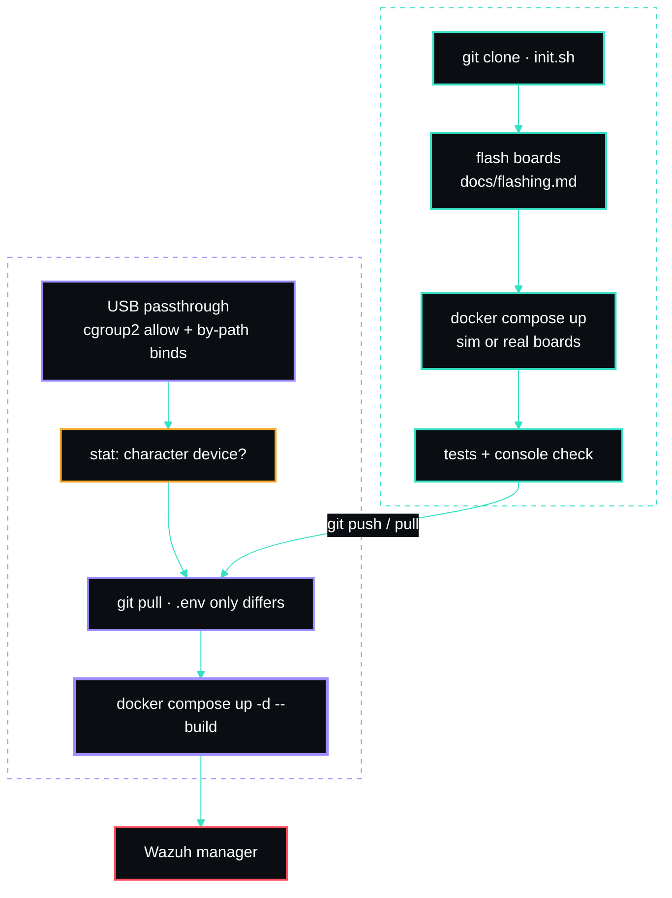

# Deployment (dev → prod)

The same `docker-compose.yml` runs on the dev box and the production Proxmox LXC — **only `.env`
changes** (host IP, serial ports, Wazuh target). Develop and fully test here with the boards
attached, then move the repo and bring it up on the LXC.




## Dev server (this box · `spectre-dev`, 10.0.0.10)

```bash
bash init.sh
# boards flashed with the v2 firmware? set SERIAL_BAUD=460800 in .env (docs/flashing.md)
docker compose up -d --build
# open http://10.0.0.10:4100
```

Verified working: the containerized reader opens the tty with DTR/RTS low and ingests real frames;
band is auto-detected from each board's boot event.

## Production LXC (Proxmox)

1. `git clone` the repo onto the LXC, `bash init.sh`, edit `.env` for the prod host/Wazuh, and set
   `SERIAL_BAUD` to the firmware's speed.
2. Plug the two boards into the Proxmox host and pass them into the LXC (below).
3. Flash them from inside the LXC if they are not on the v2 firmware yet: [flashing.md](flashing.md).
   `flash.py` needs only Python and `uv`, and the passthrough below is all the access it needs.
4. `docker compose up -d --build`.

### USB passthrough into an **unprivileged** LXC

Unprivileged LXCs can't see host USB serial devices by default. On the **Proxmox host**, find the
adapters and add to the container config (`/etc/pve/lxc/<vmid>.conf`):

```
# major:minor of /dev/ttyUSB* — check with: ls -l /dev/ttyUSB*
lxc.cgroup2.devices.allow: c 188:* rwm
# bind each physical USB port (find yours with: ls -l /dev/serial/by-path/)
lxc.mount.entry: /dev/serial/by-path/<port-of-board-A> dev/ttyUSB0 none bind,optional,create=file
lxc.mount.entry: /dev/serial/by-path/<port-of-board-B> dev/ttyUSB1 none bind,optional,create=file
```

Restart the container. Inside it, check that both are real devices before starting the stack:

```bash
stat -c '%F' /dev/ttyUSB0 /dev/ttyUSB1    # "character special file", never "regular empty file"
```

Docker's `devices:` mapping in `docker-compose.yml` then passes them to the `sensor` container.

> **Why `by-path`.** Binding `/dev/ttyUSB0` directly works until the host re-enumerates and the names
> swap; SPECTRE itself does not mind (it reads each board's band from its boot line), but a bind to a
> name that is briefly absent at container start leaves an **empty file** in its place, silently.
> `/dev/serial/by-id/` would be ideal, but many CH340 adapters have no USB serial number and both
> boards collapse into one link. `by-path` names the physical port, so keep each board in its port.
> More in [hardware.md](hardware.md#stable-port-names).

### Fallback: reader on the host

If device-cgroup passthrough is blocked in your environment, run the reader on the LXC host and
point it at the containerized API — the reader is modular (`SerialReader` + `Parser` feed
`Pipeline.ingest`), so a thin host script can POST/stream frames in. Containerized passthrough is
the supported default.

## Resource notes

`docker-compose.yml` caps the `sensor` at 512M / 1 CPU and `web` at 384M / 0.75 CPU to respect the
host RAM guard. Adjust `deploy.resources` if you raise the LXC's limits.

## NPM / TLS (optional)

Front the console with Nginx Proxy Manager for TLS + access control:

```bash
docker compose -f docker-compose.yml -f docker-compose.npm.yml up -d
```

_Author: gurvinny · Project: SPECTRE_
