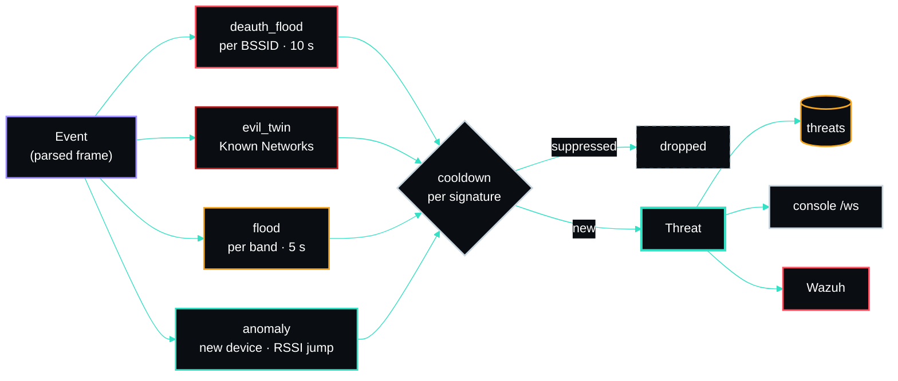

# Detection Rules

All detection is server-side, over the normalized event stream, tuned live from **Settings**
(stored in SQLite). Each rule is a small stateful module in `sensor/spectre/detect/`. A detected
`Threat` is rate-limited by a per-signature cooldown (`threat_cooldown_seconds`) so one ongoing
attack does not re-fire every frame.

## Severity → syslog mapping

| Threat severity | UI rank | Syslog severity | PRI (local7) |
|---|---|---|---|
| `critical` | 1 | crit (2) | `<186>` |
| `high` | 2 | err (3) | `<187>` |
| `medium` | 3 | warning (4) | `<188>` |
| `low` | 4 | notice (5) | `<189>` |
| `info` / summary | 5 | info (6) | `<190>` |

## Rules

### Deauth / disassoc flood — `deauth_flood.py`
Counts `DEAUTH`+`DISASSOC` per BSSID over a sliding window. Fires `high` when the count crosses the
threshold. The classic WiFi DoS / handshake-capture signature.

- `deauth_threshold` (default 20), `deauth_window_seconds` (default 10).

### Rogue AP / Evil Twin — `evil_twin.py`
Watches AP-originated frames (`BEACON`/`PROBE_RESP`). A trusted SSID advertised from a BSSID **not
on the allowlist** fires `critical`; the same SSID on an unexpected band fires `high`.

- Managed via **Settings → Known Networks**. For a mesh/multi-AP SSID, allowlist *every* legitimate
  BSSID (otherwise the others read as evil twins).
- A band on an entry with a BSSID pins **that BSSID**; add one entry per band if a radio uses both.
  A dual-band network lists each radio with its own band (most dual-band APs use a separate BSSID
  per band). A band on an entry with no BSSID pins the whole SSID and applies only to BSSIDs that
  have no pin of their own. Leave the band blank to skip the band check.
- `evil_twin_learn` (default off) baselines the first BSSID seen per SSID when there is no allowlist
  entry — convenient, but only enable once the air is known-clean.

### Beacon / probe flood — `flood.py`
- **Beacon flood**: too many *distinct* BSSIDs beaconing within the window (`beacon_flood_distinct_bssids`, default 40) → `medium`. Catches mdk4/airbase-style fake-AP spam. Counted **per band**, each band with its own window and cooldown, so a 2.4 GHz and a 5 GHz board's ordinary neighbourhoods do not add up to a flood.
- **Probe flood**: `PROBE_REQ` rate above `probe_flood_threshold` (default 120) in the window → `medium`.
- `flood_window_seconds` (default 5), `flood_cooldown_seconds` (default 30).

### New device / RSSI anomaly — `anomaly.py`
- **New device**: first-seen non-AP client MAC → `low`. Randomized (locally-administered) MACs are
  **muted by default** (they're constant and expected); enable `alert_randomized_devices` to include
  them.
- **RSSI jump**: a station's RSSI changing by ≥ `rssi_jump_db` (default 55) between observations →
  `low`. Possible spoofing / proximity change. Observations are only compared on the **same band and
  channel**: a hopping radio also hears a strong AP, much weaker, on neighbouring channels (adjacent-channel
  leakage), and that difference is not a change in the device. A previous reading older than
  `rssi_jump_max_age_seconds` (default 10, about two channel sweeps) is not compared against.

## Tuning notes

- Thresholds scale with your environment's density — a busy office needs higher flood thresholds
  than a quiet lab.
- `new_device_alerts` can be turned off entirely in high-churn environments; the flood rule still
  catches the actual reconnaissance bursts.

_Author: gurvinny · Project: SPECTRE_
