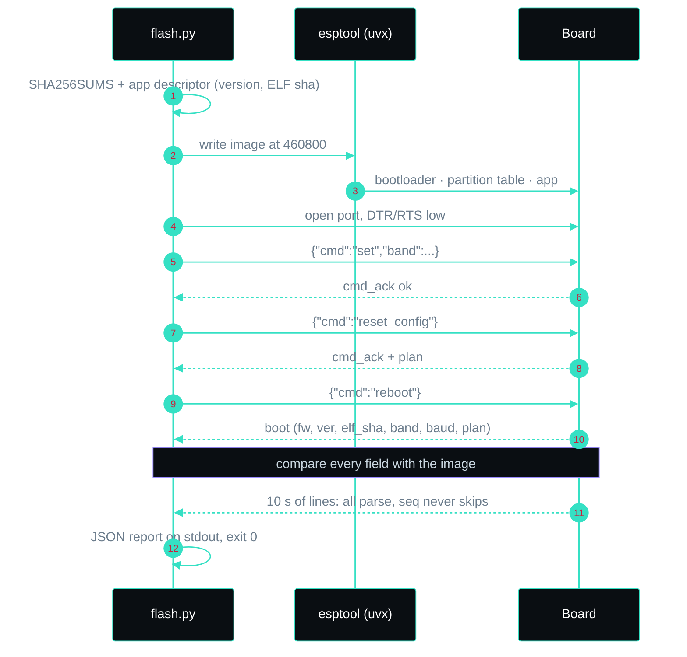

# Flashing the boards

The operator's guide: get a firmware image, flash both boards, prove they run it, and get back to the old
image if you need to. For how the firmware works, its wire format and its commands, see the
[firmware README](../firmware/README.md). For the boards, cabling and host passthrough, see
[hardware.md](hardware.md).

One image serves both bands. Which band a board watches is a setting stored in its NVS, so the same file is
flashed to both boards and `flash.py` assigns the band afterwards.

```mermaid
%%{init: {
  'theme': 'base',
  'themeVariables': {
    'primaryColor': '#0a0e12',
    'primaryTextColor': '#fff',
    'primaryBorderColor': '#35E0C4',
    'lineColor': '#35E0C4',
    'secondaryColor': '#0a0e12',
    'tertiaryColor': '#0a0e12',
    'actorBkg': '#0a0e12',
    'actorBorder': '#35E0C4',
    'actorTextColor': '#fff',
    'signalColor': '#35E0C4',
    'signalTextColor': '#6B7C8C',
    'noteBkgColor': '#0a0e12',
    'noteBorderColor': '#9B8CFF',
    'noteTextColor': '#C9D6DF',
    'labelBoxBkgColor': '#0a0e12',
    'labelBoxBorderColor': '#9B8CFF',
    'labelTextColor': '#fff',
    'loopTextColor': '#6B7C8C',
    'activationBkgColor': '#11171d',
    'activationBorderColor': '#35E0C4',
    'fontFamily': 'monospace'
  }
}}%%
flowchart LR
    G["1 · Get an image<br/>CI artifact or idf.py build"] --> X["2 · Stop readers<br/>docker compose stop sensor"]
    X --> K{"First flash<br/>over original fw?"}
    K -- "yes" --> BK["3 · Back up flash<br/>read twice, compare"]
    K -- "no" --> F
    BK --> F["4 · flash.py per board<br/>write · set band · reboot"]
    F --> V{"boot line +<br/>10 s soak OK?"}
    V -- "no" --> RB["Roll back<br/>write-flash backup"]
    V -- "yes" --> BD["5 · SERIAL_BAUD=460800"]
    BD --> U["6 · Start sensor<br/>reset boards to log boot"]

    style G fill:#0a0e12,stroke:#9B8CFF,stroke-width:2px,color:#fff
    style X fill:#0a0e12,stroke:#35E0C4,stroke-width:2px,color:#fff
    style K fill:#0a0e12,stroke:#F5A623,stroke-width:2px,color:#fff
    style BK fill:#0a0e12,stroke:#F5A623,stroke-width:2px,color:#fff
    style F fill:#0a0e12,stroke:#35E0C4,stroke-width:3px,color:#fff
    style V fill:#0a0e12,stroke:#F5A623,stroke-width:2px,color:#fff
    style RB fill:#0a0e12,stroke:#FF4D5E,stroke-width:2px,color:#fff
    style BD fill:#0a0e12,stroke:#35E0C4,stroke-width:2px,color:#fff
    style U fill:#0a0e12,stroke:#C9D6DF,stroke-width:2px,color:#fff
```




## What you need

- Both boards connected and visible as `/dev/ttyUSB*` (see [hardware.md](hardware.md)).
- Python 3.10+ and [uv](https://docs.astral.sh/uv/). `flash.py` fetches a pinned esptool through `uvx`;
  nothing else is installed.
- A firmware image: the CI artifact or your own build (next section).
- Shell access to the port as a member of `dialout`.

## 1. Get an image

**From CI (no toolchain needed).** Every push to `main` builds the image in the `Firmware build` job and
uploads it as the `spectre-sniffer-esp32c5` artifact (kept 30 days), with a `SHA256SUMS` file:

```bash
gh run list --workflow ci.yml --branch main --status success --limit 1
gh run download <run-id> -n spectre-sniffer-esp32c5 -D fw-image
```

**From source.** Install ESP-IDF **v5.5** or later with the `esp32c5` target, then:

```bash
. $IDF_PATH/export.sh
cd firmware/spectre-sniffer
idf.py set-target esp32c5   # first time only
idf.py build                # image lands in build/
```

CI builds with the `espressif/idf:v5.5.4` container. To match it exactly without a local install:

```bash
docker run --rm -v "$PWD":/project -w /project/firmware/spectre-sniffer \
  espressif/idf:v5.5.4 idf.py set-target esp32c5 build
```

## 2. Stop everything that reads the ports

Two readers on one port each see about half the lines, and esptool cannot take a port that is open.

```bash
docker compose stop sensor
```

Close any serial monitor too. `fuser /dev/ttyUSB0 /dev/ttyUSB1` should print nothing.

## 3. Back up each board once, before the first flash

Do this before the first flash over the firmware a board shipped with. It is the only way back to it.

```bash
uvx --from esptool==5.6.0 esptool --port /dev/ttyUSB0 --baud 460800 read-flash 0 ALL board0-a.bin
uvx --from esptool==5.6.0 esptool --port /dev/ttyUSB0 --baud 460800 read-flash 0 ALL board0-b.bin
cmp board0-a.bin board0-b.bin && sha256sum board0-a.bin
```

Read it twice and compare, then repeat for the other port. Keep the backups **private**: NVS can hold
Wi-Fi credentials, and the image carries the board's MAC address. 921600 baud is not reliable on every
USB-serial adapter; 460800 is.

## 4. Flash and verify

```bash
python3 firmware/flash.py --port /dev/ttyUSB0 --band 2.4GHz --build fw-image > flash-2.4ghz.json
python3 firmware/flash.py --port /dev/ttyUSB1 --band 5GHz   --build fw-image > flash-5ghz.json
```

Leave out `--build` to flash `firmware/spectre-sniffer/build/`. For each board, `flash.py`:

1. checks the image against `SHA256SUMS` when one is present, and reads the version and ELF sha256 from
   the app descriptor inside the image;
2. writes it with esptool at 460800 (with `--no-stub` when the build's `flasher_args.json` asks for it,
   as ESP-IDF does for the C5);
3. opens the port with DTR and RTS held low, sets the band, restores that band's default channel plan
   (`--keep-config` keeps the current one) and reboots the board by command;
4. checks the new `boot` line against the image (firmware name, version, ELF sha, band, baud and plan);
5. soaks for 10 s (`--soak N`, `0` skips): every line must parse and frame `seq` must not skip.

The JSON report on stdout holds the sha256 of every file written; esptool's output goes to stderr. Any
mismatch or silence exits non-zero. Keep the reports: they are your record of what each board runs.

`--verify-only` runs steps 3 to 5 against a board without flashing it.




Plain `idf.py -p /dev/ttyUSB0 -b 460800 flash` also works. A fresh board then boots on the 2.4 GHz plan;
send `{"cmd":"set","band":"5GHz"}` to make it the 5 GHz board. The band is saved in NVS and survives
reflashing the app.

## 5. Point the sensor at the new speed

The v2 firmware talks at **460800** baud; the original firmware used 115200. Set it in `.env`:

```bash
SERIAL_BAUD=460800
```

`SERIAL_BAUD` is read on every start (it is not seeded into the settings database). An unsupported value
stops the sensor at startup on purpose: reading at the wrong speed produces garbage that would otherwise
look like a quiet board.

## 6. Start the sensor and record the boot lines

```bash
docker compose up -d sensor
```

The `boot` line `flash.py` checked was printed while the sensor was stopped, so the sensor never saw it.
Within 10 s the **Boards** page shows each board's version from its telemetry, with a *Boot line
missed* note: the reset reason, baud and plan shown may be from an earlier boot. To record a current boot
line, restart each board while the sensor is running: press the board's **RST** button, or with
`SPECTRE_BOARD_CONTROL=true` use **Reboot** then **Confirm reboot** on the Boards page. The new boot row
lands in `board_events` and the note clears.

Check each board on the Boards page: firmware version, band, channel plan, loss and UART load.

## Updating a board that already runs v2

Repeat steps 1, 2, 4 and 6. The backup is only needed once, and `SERIAL_BAUD` is already set. Board
settings in NVS survive an app update; `flash.py` resets the plan to the band defaults unless you pass
`--keep-config`.

## Rolling back

```bash
docker compose stop sensor
uvx --from esptool==5.6.0 esptool --port /dev/ttyUSB0 --baud 460800 write-flash 0 board0-a.bin
```

This restores the old application, partition table and NVS exactly as they were read. Set `SERIAL_BAUD`
back to what the old firmware used (115200 for the original sniffer sketch), then start the sensor.

## Troubleshooting

| Symptom | Cause and fix |
|---|---|
| `flash.py` times out waiting for the boot line | Something else holds the port, or the board is on another adapter. Check `fuser`, and that `--port` is the board you mean. |
| esptool cannot connect | On most dev boards: hold **BOOT**, tap **RST**, release **BOOT** to enter the ROM bootloader by hand, then run again. A charge-only USB cable also looks like this. |
| Sensor exits at startup | `SERIAL_BAUD` is not one of the supported rates. |
| Lines arrive as garbage | `SERIAL_BAUD` does not match the firmware (115200 vs 460800). |
| Every port open restarts the board | The reader is not holding DTR/RTS low. Use the sensor's reader or `flash.py`, or a tool that can clear both lines before opening. |
| A board reports the wrong band | Set it by command (`{"cmd":"set","band":"5GHz"}`) or re-run `flash.py` with the right `--band`. |
| Boards page keeps the *Boot line missed* note | The sensor was stopped when the board last booted. Restart the board with the sensor running (step 6). |

_Author: gurvinny · Project: SPECTRE_
