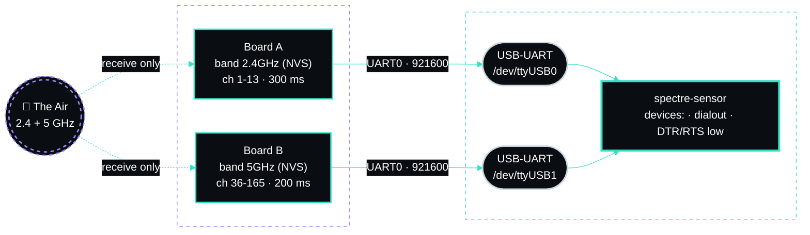

# Hardware

SPECTRE listens with two **ESP32-C5** boards, one per band. The C5 is a dual-band (2.4 GHz and 5 GHz)
Wi-Fi 6 chip, but a radio can only be tuned to one channel at a time, so each band gets its own board and
both hop in parallel.

## Bill of materials

| Item | Qty | Notes |
|---|---|---|
| ESP32-C5 development board | 2 | Any ESP32-C5 board. The firmware streams on the chip's **native USB-Serial/JTAG port** (`/dev/ttyACM*`, firmware 2.1.0+) whenever a USB host is attached to it, and on **UART0** otherwise, which a USB-to-UART bridge exposes as `/dev/ttyUSB*`. On boards with two USB connectors, the native one is usually marked USB, the bridge one UART. See [Native USB](#native-usb-firmware-210). |
| USB data cable | 2 | Charge-only cables power the board but carry no data: the port never appears. |
| Host | 1 | Linux with Docker. The sensor container is capped at 512 MB and one CPU; the console at 384 MB. |
| USB hub (optional) | 1 | A powered hub if the host's ports cannot supply both boards. |

No antenna work, no soldering and no transmit hardware: the firmware runs Wi-Fi in `NULL` mode with
promiscuous receive only and never transmits.




## Which board is which

It does not matter which board you flash first or which port it lands on. Each board carries its band in
NVS, announces it in its `boot` line, and the sensor labels that board's frames by it, so
`/dev/ttyUSB0` and `/dev/ttyUSB1` swapping after a reboot changes nothing. Set the band when you flash
(see [flashing.md](flashing.md)); a stuck label is put right by command.

Place the boards where they hear the area you want to watch, apart from large metal surfaces. They share no
state with each other.

## Getting the ports to the sensor

The sensor container reads the boards through the `devices:` list in `docker-compose.yml`, joins the
`dialout` group, and opens each port with DTR and RTS held low. Most ESP32 dev boards wire those lines to
reset and boot-mode, so any reader that does not hold them low reboots the board on every open and restarts
its `seq` counter.

1. Plug both boards in and confirm the host sees them:

   ```bash
   ls -l /dev/ttyUSB*
   stat -c '%F' /dev/ttyUSB0 /dev/ttyUSB1    # must print "character special file"
   ```

2. List the same paths in `SERIAL_PORTS` in `.env` and in `devices:` in `docker-compose.yml`. Docker
   refuses to start a container whose listed device does not exist, so with one board attached, list only
   that one.

3. Set `SERIAL_BAUD` to the firmware's speed: `921600` for the v2 firmware (`460800` up to 2.0.4),
   `115200` for the original sniffer firmware.

### Stable port names

Two identical adapters can swap `ttyUSB0` and `ttyUSB1` across reboots. SPECTRE does not care, but a
passthrough configuration that binds a specific path does.

- `/dev/serial/by-id/` names an adapter by its USB serial number. Many CH340-based boards have **no serial
  number**, so both boards collapse into one `by-id` link. Check with `ls -l /dev/serial/by-id/`.
- `/dev/serial/by-path/` names the **physical USB port**. It stays stable as long as each board stays in
  the same port, and is the reliable choice for identical adapters.

### Unprivileged Proxmox LXC

An unprivileged container cannot see host serial devices by default. Pass them through on the Proxmox host
as shown in [deployment.md](deployment.md#usb-passthrough-into-an-unprivileged-lxc), preferably binding
`by-path` names.

**The silent failure:** with `optional,create=file`, a mount entry whose source does not exist when the
container starts creates a **regular empty file** at the target instead of a device. Docker accepts the
path and the reader just fails to open it. If `stat -c '%F'` inside the container prints
`regular empty file`, the bind pointed at the wrong source (often the wrong `by-path` port): fix the entry
and restart the container.

## Native USB (firmware 2.1.0)

The ESP32-C5 has a USB-Serial/JTAG controller of its own. Cabled to the host on that connector, a board
shows up as a CDC-ACM port (`ttyACM*`) with **no baud rate and no bridge chip**: the 921600 baud ceiling
goes away, and so do the byte drops a UART bridge can add at that rate. The port reports the chip's MAC as
its USB serial number, so each board has a name that survives port swaps.

What changes with it:

- **The link is chosen per line.** While a USB host is attached to the native port (it sees the host's
  start-of-frame packets every millisecond), every line goes there and UART0 stays quiet; without one,
  lines go to UART0 as before. The `boot` line says which (`"link":"usb"` or `"uart"`), and every
  `telemetry` line names the current link. With both cables plugged in, the UART bridge receives nothing.
- **Loss is counted on the board.** A line the host does not take within 20 ms (nothing has the port open,
  or the reader stalls) is refused whole, never half-written, and counted in `drop_usb`. After one refusal
  the next lines are refused at once until the host reads again, so a closed port cannot slow the capture
  path. When a reader opens the port, it first receives what the board buffered before the stall (up to
  8 KB, the oldest lines); the counters in the next `telemetry` line cover the gap.
- **The port disappears on every chip reset** (`reboot` command, flash, crash) and comes back a second or
  two later as a new device. The sensor's reader and `flash.py` both reopen the port when that happens. A
  container given the device itself (`devices:`) would keep the dead one, so the sensor gets a
  **directory of stable nodes** instead, below.
- **Opening the port does not reset the board.** Checked on ESP32-C5 boards: a plain open (DTR and RTS
  asserted) and the reader's recipe (both held low) leave the board running, with no re-enumeration.

### Stable nodes for a container

`firmware/scripts/99-espc5.rules` runs `firmware/scripts/espc5-node` on the host whenever a native port
comes or goes. It keeps one node per board at `/dev/espc5/<MAC without colons>`, made with `mknod` rather
than as a symlink, because a symlink into the host's `/dev` points nowhere inside a container:

```bash
sudo install -m 0755 firmware/scripts/espc5-node /usr/local/sbin/
sudo install -m 0644 firmware/scripts/99-espc5.rules /etc/udev/rules.d/
sudo udevadm control --reload && sudo udevadm trigger --subsystem-match=tty
ls -l /dev/espc5/              # one character device (major 166) per board
```

Then start the sensor with the USB overlay, which drops the `devices:` list, binds `/dev/espc5`, and lets
the container open CDC-ACM ttys (`c 166:* rmw`) and nothing else:

```bash
# .env
COMPOSE_FILE=docker-compose.yml:docker-compose.usb.yml
SERIAL_PORTS=/dev/espc5/<MAC>,/dev/espc5/<MAC>
```

Which board is which still does not matter: each one announces its band (see
[Which board is which](#which-board-is-which)).

**Unprivileged LXC.** Make the node directory on the Proxmox host as above, then bind the directory into
the container (`lxc.mount.entry: /dev/espc5 dev/espc5 none bind,optional,create=dir`) and allow the device
class (`lxc.cgroup2.devices.allow: c 166:* rwm`). The host's `dialout` group is unmapped inside an
unprivileged container, so the nodes need `ESPC5_MODE=0666` there (set it in the rule's `RUN`). Bind the
directory, not the nodes: a node bound by name goes stale at the first reset, like a Docker device.

### JTAG stays reachable

The same USB port also carries the chip's JTAG interface, and it stays live unless the `DIS_USB_JTAG`
eFuse is burned (permanent; the firmware does not burn it). Anything that can open the raw USB device
(`/dev/bus/usb/...`, major 189) can halt the chip, read its RAM and rewrite its flash, which is also what
makes OpenOCD and gdb work on a running board. The tty above is a different device and gives none of
that. Keep `/dev/bus/usb` out of the sensor container (the overlay never passes it), and on the host keep
the board's USB device nodes at their default permissions rather than opening them to every user.

## Limits worth knowing before you buy

- **One channel at a time per board.** While hopping, each board hears each channel for its dwell time out
  of every sweep (about 3.9 s on 2.4 GHz and 5.0 s on 5 GHz with the defaults). Events shorter than a sweep
  can be missed; pinning a channel trades coverage for depth.
- **20/40 MHz receive.** The C5 decodes 802.11a/b/g/n/ac/ax at 20 MHz and 802.11n at 40 MHz. Wider
  80/160 MHz transmissions are not received; beacons and other management frames are sent at 20 MHz and are
  seen.
- **UART bandwidth.** 921600 baud is about 92 KB/s per board. Frames beyond that are counted in
  `drop_queue`, not lost silently, and the Boards page shows the loss.

_Author: gurvinny · Project: SPECTRE_
