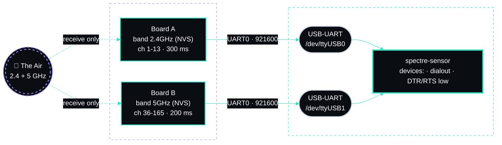

# Hardware

SPECTRE listens with two **ESP32-C5** boards, one per band. The C5 is a dual-band (2.4 GHz and 5 GHz)
Wi-Fi 6 chip, but a radio can only be tuned to one channel at a time, so each band gets its own board and
both hop in parallel.

## Bill of materials

| Item | Qty | Notes |
|---|---|---|
| ESP32-C5 development board | 2 | Any board that exposes **UART0 through a USB-to-UART bridge** (it enumerates as `/dev/ttyUSB*`). The firmware talks on UART0, not the chip's native USB-Serial/JTAG port (`/dev/ttyACM*`). On boards with two USB connectors, use the one marked UART. |
| USB data cable | 2 | Charge-only cables power the board but carry no data: the port never appears. |
| Host | 1 | Linux with Docker. The sensor container is capped at 512 MB and one CPU; the console at 384 MB. |
| USB hub (optional) | 1 | A powered hub if the host's ports cannot supply both boards. |

No antenna work, no soldering and no transmit hardware: the firmware runs Wi-Fi in `NULL` mode with
promiscuous receive only and never transmits.




## Which board is which

It does not matter which board you flash first or which port it lands on. Each board carries its band in
NVS, announces it in its `boot` line, and the sensor labels that board's frames by it, so
`/dev/ttyUSB0` and `/dev/ttyUSB1` swapping after a reboot changes nothing. Set the band when you flash
(see [flashing.md](flashing.md)); a stuck label is put right by command.

Place the boards where they hear the area you want to watch, apart from large metal surfaces. They share no
state with each other.

## Getting the ports to the sensor

The sensor container reads the boards through the `devices:` list in `docker-compose.yml`, joins the
`dialout` group, and opens each port with DTR and RTS held low. Most ESP32 dev boards wire those lines to
reset and boot-mode, so any reader that does not hold them low reboots the board on every open and restarts
its `seq` counter.

1. Plug both boards in and confirm the host sees them:

   ```bash
   ls -l /dev/ttyUSB*
   stat -c '%F' /dev/ttyUSB0 /dev/ttyUSB1    # must print "character special file"
   ```

2. List the same paths in `SERIAL_PORTS` in `.env` and in `devices:` in `docker-compose.yml`. Docker
   refuses to start a container whose listed device does not exist, so with one board attached, list only
   that one.

3. Set `SERIAL_BAUD` to the firmware's speed: `921600` for the v2 firmware (`460800` up to 2.0.4),
   `115200` for the original sniffer firmware.

### Stable port names

Two identical adapters can swap `ttyUSB0` and `ttyUSB1` across reboots. SPECTRE does not care, but a
passthrough configuration that binds a specific path does.

- `/dev/serial/by-id/` names an adapter by its USB serial number. Many CH340-based boards have **no serial
  number**, so both boards collapse into one `by-id` link. Check with `ls -l /dev/serial/by-id/`.
- `/dev/serial/by-path/` names the **physical USB port**. It stays stable as long as each board stays in
  the same port, and is the reliable choice for identical adapters.

### Unprivileged Proxmox LXC

An unprivileged container cannot see host serial devices by default. Pass them through on the Proxmox host
as shown in [deployment.md](deployment.md#usb-passthrough-into-an-unprivileged-lxc), preferably binding
`by-path` names.

**The silent failure:** with `optional,create=file`, a mount entry whose source does not exist when the
container starts creates a **regular empty file** at the target instead of a device. Docker accepts the
path and the reader just fails to open it. If `stat -c '%F'` inside the container prints
`regular empty file`, the bind pointed at the wrong source (often the wrong `by-path` port): fix the entry
and restart the container.

## Limits worth knowing before you buy

- **One channel at a time per board.** While hopping, each board hears each channel for its dwell time out
  of every sweep (about 3.9 s on 2.4 GHz and 5.0 s on 5 GHz with the defaults). Events shorter than a sweep
  can be missed; pinning a channel trades coverage for depth.
- **20/40 MHz receive.** The C5 decodes 802.11a/b/g/n/ac/ax at 20 MHz and 802.11n at 40 MHz. Wider
  80/160 MHz transmissions are not received; beacons and other management frames are sent at 20 MHz and are
  seen.
- **UART bandwidth.** 921600 baud is about 92 KB/s per board. Frames beyond that are counted in
  `drop_queue`, not lost silently, and the Boards page shows the loss.

_Author: gurvinny · Project: SPECTRE_
