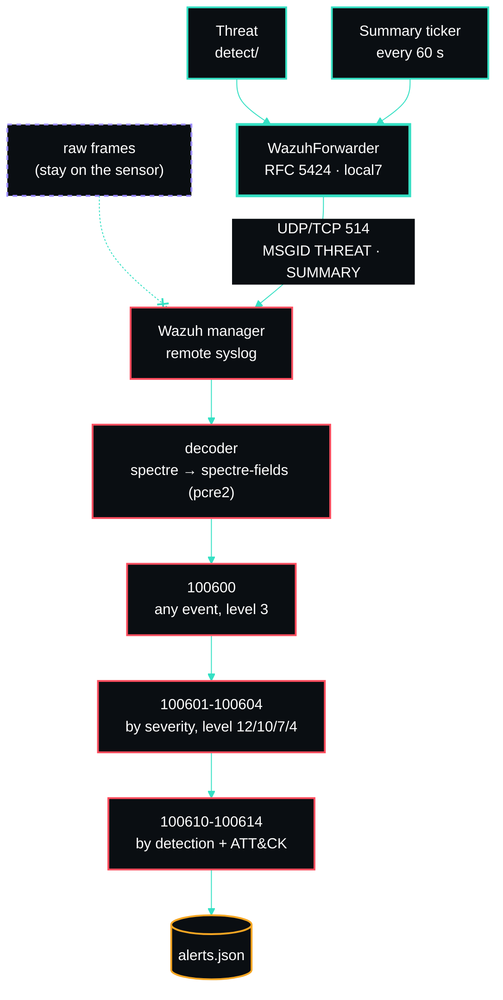

# Wazuh Integration

SPECTRE forwards **threats and periodic summaries** (never raw frames) to Wazuh as RFC 5424 syslog.




## Wire format

```
<186>1 2026-07-09T02:17:02.055Z spectre spectre - THREAT [spectre@32473 band="5GHz" rule="evil_twin" bssid="00:00:5E:00:53:06" ssid="ExampleNet" severity="critical"] {"kind":"threat","ts":...,"rule":"evil_twin","severity":"critical","rank":1,"title":"Evil twin: 'ExampleNet' from unexpected BSSID 00:00:5E:00:53:06","band":"5GHz","bssid":"...","ssid":"ExampleNet","src":null,"detail":{...}}
```

- **PRI** = `local7 (23) × 8 + syslog severity`. Severity is mapped from the threat (see
  [detection-rules.md](detection-rules.md)); e.g. `<186>` = crit, `<190>` = summary/info.
- **app-name** = `spectre` (configurable), **MSGID** = `THREAT` or `SUMMARY`.
- **STRUCTURED-DATA** carries `band` / `rule` / `bssid` / `ssid` / `severity` for quick filtering.
- **MSG** is a compact JSON object Wazuh can decode natively (`kind`, `rule`, `severity`, `title`,
  `band`, `bssid`, `ssid`, `detail`).

## Receiving it

On the Wazuh manager, accept remote syslog from the sensor (`/var/ossec/etc/ossec.conf`):

```xml
<remote>
  <connection>syslog</connection>
  <port>514</port>
  <protocol>udp</protocol>
  <allowed-ips>10.0.0.10</allowed-ips>
</remote>
```

Point SPECTRE at the manager in **Settings** (or `.env`): `WAZUH_HOST=10.0.0.20`,
`WAZUH_PORT=514`, `WAZUH_PROTO=udp` (use `tcp` for guaranteed delivery across network segments).

## Decoder — `/var/ossec/etc/decoders/spectre_decoder.xml`

```xml
<decoder name="spectre">
  <program_name>spectre</program_name>
</decoder>

<!-- One child decoder pulls every field out of the JSON body, in the order the sensor writes them.
     PCRE2 because Wazuh's default OS_Regex has no character classes. -->
<decoder name="spectre-fields">
  <parent>spectre</parent>
  <regex type="pcre2">"rule":"(\w+)","severity":"(\w+)","rank":\d+,"title":"((?:[^"\\]|\\.)*)","band":"((?:[^"\\]|\\.)*)"</regex>
  <order>spectre.rule,spectre.severity,spectre.title,spectre.band</order>
</decoder>
```

## Rules — `/var/ossec/etc/rules/spectre_rules.xml`

The severity rules set the alert level. The detection rules below them refine one detection each
and carry its ATT&CK technique, so a technique is never inferred from severity alone (two
detections share `high`).

```xml
<group name="spectre,wireless,">
  <rule id="100600" level="3">
    <decoded_as>spectre</decoded_as>
    <description>SPECTRE: wireless sensor event</description>
  </rule>

  <rule id="100601" level="12">
    <if_sid>100600</if_sid>
    <field name="spectre.severity">^critical$</field>
    <description>SPECTRE: $(spectre.title)</description>
  </rule>

  <rule id="100602" level="10">
    <if_sid>100600</if_sid>
    <field name="spectre.severity">^high$</field>
    <description>SPECTRE: $(spectre.title)</description>
  </rule>

  <rule id="100603" level="7">
    <if_sid>100600</if_sid>
    <field name="spectre.severity">^medium$</field>
    <description>SPECTRE: $(spectre.title)</description>
  </rule>

  <rule id="100604" level="4">
    <if_sid>100600</if_sid>
    <field name="spectre.severity">^low$</field>
    <description>SPECTRE: $(spectre.title)</description>
  </rule>

  <rule id="100610" level="12">
    <if_sid>100601</if_sid>
    <field name="spectre.rule">^evil_twin$</field>
    <description>SPECTRE evil twin: $(spectre.title)</description>
    <mitre><id>T1557</id></mitre>
  </rule>

  <rule id="100611" level="10">
    <if_sid>100602</if_sid>
    <field name="spectre.rule">^evil_twin$</field>
    <description>SPECTRE rogue AP on unexpected band: $(spectre.title)</description>
    <mitre><id>T1557</id></mitre>
  </rule>

  <rule id="100612" level="10">
    <if_sid>100602</if_sid>
    <field name="spectre.rule">^deauth_flood$</field>
    <description>SPECTRE deauth flood: $(spectre.title)</description>
    <mitre><id>T1499</id></mitre>
  </rule>

  <rule id="100613" level="7">
    <if_sid>100603</if_sid>
    <field name="spectre.rule">^beacon_probe_flood$</field>
    <field name="spectre.title" type="pcre2">^Beacon flood</field>
    <description>SPECTRE beacon flood: $(spectre.title)</description>
    <mitre><id>T1498</id></mitre>
  </rule>

  <rule id="100614" level="7">
    <if_sid>100603</if_sid>
    <field name="spectre.rule">^beacon_probe_flood$</field>
    <field name="spectre.title" type="pcre2">^Probe-request flood</field>
    <description>SPECTRE probe-request flood: $(spectre.title)</description>
    <mitre><id>T1595</id></mitre>
  </rule>
</group>
```

## MITRE ATT&CK mapping

ATT&CK Enterprise has no 802.11-specific techniques, so each detection maps to the closest
technique for what the attacker gains, not for the radio mechanism.

| Detection | Wazuh rule | Technique | Tactic | Why |
|---|---|---|---|---|
| Evil twin (`evil_twin`, critical) | 100610 | T1557 Adversary-in-the-Middle | Credential Access, Collection | A cloned SSID from an unknown BSSID exists to pull clients through the attacker's AP. |
| Rogue AP on unexpected band (`evil_twin`, high) | 100611 | T1557 Adversary-in-the-Middle | Credential Access, Collection | A known SSID on a band it is pinned away from is the same cloned-AP setup, seen by band instead of BSSID. |
| Deauth / disassoc flood (`deauth_flood`) | 100612 | T1499 Endpoint Denial of Service | Impact | Forged management frames knock clients off their AP. Also the usual first step of a handshake capture or an evil twin. |
| Beacon flood (`beacon_probe_flood`) | 100613 | T1498 Network Denial of Service | Impact | Hundreds of fabricated APs bury the real ones in every client's network list. |
| Probe-request flood (`beacon_probe_flood`) | 100614 | T1595 Active Scanning | Reconnaissance | A probe burst makes every AP in range answer with its SSID and capabilities. |
| RSSI jump (`anomaly`, low) | none | none | | A sharp signal change fits spoofing, a device moving, or multipath. It is an indicator to investigate, not an adversary behaviour, and the spoofing case is already covered by the evil-twin rules. |
| New device (`anomaly`, low/info) | none | none | | Inventory awareness. A new MAC on the air is not by itself an attack. |

Restart the manager (`systemctl restart wazuh-manager`) and test with
`/var/ossec/bin/wazuh-logtest`, pasting a captured line.

> **Version note:** RFC 5424 predecoding varies across Wazuh versions. The decoder above keys off
> the JSON body (the most stable part) rather than the syslog header, so it works regardless of how
> the manager predecodes the 5424 frame. It needs a manager with PCRE2 support (`type="pcre2"`).
> `sensor/tests/test_wazuh_docs.py` checks these blocks against real sensor output, but it models
> Wazuh's matching in Python: `wazuh-logtest` on your manager is the final word.

_Author: gurvinny · Project: SPECTRE_
